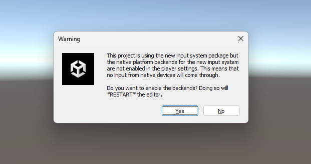
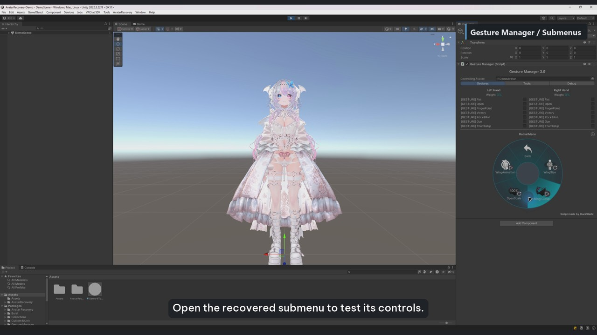

# AvatarRecovery Unity

Restore supported Unity AssetBundles into Avatar and World projects on Windows.

**Stable version 2.0.4** · [Download on GitHub](https://github.com/Nickel-JP/avatar-recovery-unity/releases/tag/v2.0.4) · [Update history](#update-history)

## Install

Choose your package manager to add the repository.

Open your Avatar or World project in VCC or ALCOM and install **Avatar Recovery**.

To update an existing installation, refresh the repository and select **2.0.4**.

VCC and ALCOM list the three newest supported versions. The withdrawn 1.3.x ZIPs are excluded from the current package directory. Their changelog entries and historical Git copies are retained.

[ALCOM](https://booth.pm/ja/items/6448396) is a cross-platform open-source alternative to VRChat Creator Companion, built on [vrc-get](https://github.com/vrc-get/vrc-get).

### Unity Input System warning

Unity is asking whether to enable the new Input System. If you're only recovering assets with AvatarRecovery, select **No** to keep your current input settings.

## VPM Repository

For a manual setup, copy the [VPM repository URL](https://nickel-jp.github.io/avatar-recovery-unity/index.json).
For vrc-get, use `vrc-get repo add` followed by that URL.

## AvatarRecover Demonstration Movie

[Watch the AvatarRecover demo](https://nickel-jp.github.io/avatar-recovery-unity/demo/)

Music: [youth — Toby Schay](https://www.youtube.com/watch?v=1fjAWslBuRA).

## AvatarRecovery Community Server

Join the official AvatarRecovery Discord server for update announcements, bug reports, troubleshooting, and discussion with other users.

[Join the AvatarRecovery Community Server](https://discord.gg/M9nFq8HXv)

日本語: [AvatarRecovery Community Serverに参加する方はこちらから](https://discord.gg/M9nFq8HXv)

## Public Verification

Before importing a manually downloaded package, compare its SHA-256 with the checksum for that version. You can also check the DLL signature against the published certificate.

- [Download verification steps](VERIFICATION.md)
- [2.0.4 SHA-256 checksum](checksums/com.nickel-jp.avatar-recovery-2.0.4.sha256.txt)
- [Code-signing certificate](certificates/avatar-recovery-self-signed-code-signing.cer)

## Reproducible Tests

The public regression suite in [Tests](Tests/README.md) targets the signed 2.0.4 package in Unity 2022.3.22f1. It creates its own materials, textures, shaders, and CSV reports; no private avatar files or product source are required. The runner checks the package hash and exports NUnit XML with the exact package identity.

The standard CI checks repository version consistency, signed update metadata, package integrity, and the absence of withdrawn downloads. Unity tests use the separate **Public Unity regression tests** workflow and require a licensed Windows runner. A successful standard CI run alone does not mean the Unity suite ran.

The signed 2.0.4 package passed 63 public EditMode tests with SDK 3.10.5 and 30 package self-tests. A local avatar fixture was recovered, saved, and reopened with SDK 3.10.6: all 18 targeted state behaviours, 18 states, 25 transitions, and 32 conditions matched the source data, with no recovery errors or missing scripts. Existing unresolved shader references still require manual repair; this does not establish complete recovery of every bundled object. [Public test results](Tests/Results/2.0.4-20261129/summary.json) · [Recovery validation scope](Tests/Results/2.0.4-20261129/recovery-summary.json)

The signed 2.0.2 package passed 124 regression tests in the Unity 2022.3.22f1 Editor and 30 package self-tests. A real Avatar and a real World were recovered, saved, and reopened in the Editor.

The signed 2.0.1 candidate passed 124 regression tests in the Windows Unity Editor and 30 package self-tests. [Public EditMode results](Tests/Results/2.0.1-20261121/summary.json)

The signed 2.0.0 candidate passed 63 public EditMode tests, 39 SDK2 compatibility tests, 13 AAO bounds tests, and 9 Gesture Mask tests in the Windows Unity Editor. The package passed all 30 package self-tests. [Public results](Tests/Results/2.0.0-20261120/summary.json)

The [local 1.2.28 result snapshot from 2026-11-08](Tests/Results/1.2.28-20261108/summary.json) records 63 passed, 0 failed, and 0 skipped public EditMode tests, with [NUnit XML](Tests/Results/1.2.28-20261108/results.xml) included. A separate local run against the same signed DLL passed 39 targeted type-reference checks; these checks and the 30 package self-tests are outside the public suite and its snapshot.

The [1.2.27 snapshot](Tests/Results/1.2.27-20261026/summary.json) retains its 63-test result. Its separate AAO/root-bounds and Gesture Layer mask checks remain historical evidence for that package.

The [1.2.26 snapshot](Tests/Results/1.2.26-20261024/summary.json) retains its 63-test result; two additional Texture2DArray checks passed separately against that package. The [1.2.25 snapshot](Tests/Results/1.2.25-20261023/summary.json) and [1.2.22 snapshot](Tests/Results/1.2.22-20261013/summary.json) retain their 63-test results, and the [historical 1.2.21 snapshot](Tests/Results/1.2.21-20261008/summary.json) retains its original 35-test result. These snapshots are local runs, not GitHub Actions results.

## Security Model and Limits

Published verification information supports distribution-integrity checks. Obtain expected values through an independently trusted channel; information downloaded only from the same compromised origin cannot establish trust by itself.

Code distributed to a client cannot guarantee confidentiality or immutability. Keep truly sensitive processing on a controlled server.

## Technical Specifications

- **Unity** — Unity 2022.3.22f1
- **VRChat SDK** — `com.vrchat.base`, 3.10.5 to below 3.11.0
- **Package ID** — `com.nickel-jp.avatar-recovery`
- **Target OS** — Windows 10 / 11
- **External extractor** — bundled AssetRipper 1.3.14
- **License** — [AvatarRecovery Custom License](LICENSE)

Avatar projects should install `VRChat SDK - Avatars`; world projects should install `VRChat SDK - Worlds`. Keep VRChat SDK packages on the same version line.

## Update History

### Version 2.0.4 - Animator and Media Recovery

- Fixes missing Animator states and transitions, including references to VRChat state behaviours.
- Recovers supported missing textures and audio after standard extraction while preserving existing assets and import settings. Ambiguous matches remain unchanged.
- Keeps unresolved source data for inspection and reports remaining recovery gaps.
- Preserves the existing shader-list, manual shader reassignment, and SDK script-reference workflows. Original shader and custom script reconstruction are not added.
- Passed 63 public EditMode tests and 30 package self-tests. Targeted Animator recovery was verified through save and reimport in Unity 2022.3.22f1; unresolved shader references remain separate from the recovery checks.

### Version 2.0.3 - Tool Layout Update

- Tool layout update.

### Version 2.0.2 - Recovery Error Messages and Menu Icon Matching

- Reports missing, empty, and in-use input files before recovery and explains when an export contains no recoverable assets.
- Preserves existing files when a destination cannot be created and stops a retry while a previous external process has not been confirmed to exit.
- Checks for missing recoverable images after the standard restoration steps and keeps files that Unity cannot import with their metadata when they can be moved safely.
- Removes the fixed size caps on Expression Menu icon matching. Unity, .NET, and available memory determine the usable sizes.

### Version 2.0.1 - WAV Import Fix

- Fixed a WAV import failure caused by zero size values in the RIFF and audio data headers of recovered 16-bit PCM AudioClips.
- AvatarRecovery corrects the two size values on the import copy. The PCM samples and asset metadata are preserved.
- Verified all 238 previously failing WAV files from the same VRCA in Unity 2022.3.22f1. The PCM payloads matched byte for byte, and all files imported as AudioClips.

### Version 2.0.0 - Recovery Console and Texture Fidelity

- The recovery screen shows the current file and keeps the last recovered file name in the fixed header after the input list clears.
- Errors appear in red at the bottom of the recovery console, with the affected step and the reported cause. Errors from earlier files remain visible if recovery continues.
- Click a log line to select it. Use Shift to select a range and Ctrl to select or deselect individual lines. Right-click the selection to copy its plain text.
- The console shows live AssetRipper output and RAM, dedicated VRAM, and Windows commit usage. A reading above 90% displays a warning while recovery continues.
- Large Texture2DArray layout corrections use a Rust worker. The PNG and Unity metadata are validated as a pair. Supported float textures and HDR cubemaps retain their original precision.

### Version 1.2.28 - Legacy SDK Script References

- Improved recovery of verified legacy SDK2 PipelineManager references and PipelineManager-derived components. Blueprint ID cleanup identifies the component type and preserves unrelated component IDs and additional fields.
- SDK script matching now checks the original assembly as well as the full type name, preventing a same-named type from another assembly from being selected. Unrecognized or ambiguous references remain unresolved with a warning.
- Rejected malformed or duplicate Script references before Blueprint ID cleanup, preserving the output when the reference cannot be verified.
- This update does not convert all SDK2 components or SDK2 event logic to SDK3 or Udon.

### Version 1.2.27 - AAO Recovery and Large-File Safety

- Fixed validation of AAO meshes hidden by fully zero-scale bones without changing their original scales, mesh data, or BlendShape weights. The additional handling applies only to the verified zero-scale case. Corrected missing-root-bone handling while preserving renderer bounds and geometry.
- Gesture Layer recovery now prefers the mask retained by the recovered avatar descriptor. When no usable retained mask exists, it uses a verified Hands Only mask or creates one; existing controller masks remain unchanged.
- Added a Continue / Cancel warning before a recovery batch containing any single file of 500 MB or larger (500,000,000 bytes). The threshold applies to each file, not the combined batch size. Large inputs can require much more memory and temporary storage than their file size.
- If an external process cannot be confirmed stopped, recovery now retains its temporary output and stops subsequent processing, the remaining batch, and automatic retries. Cleanup errors no longer discard the recorded stop state. The result explains how to check the process before retrying.

### Version 1.2.26 - Texture2DArray Recovery

- Removed the fixed 16384-pixel and 1 GiB limits from Texture2DArray image correction and corrected array layouts using the original dimensions. Unity, the operating system, and available memory still limit supported sizes.
- Fixed transparent-pixel RGB loss in uncompressed arrays, recovered missing HDR arrays, and improved material references. Improved matching for arrays with identical or normalized names and prevented confusion with CubemapArray assets.
- Preserved other recovery behavior, including Texture3D, ordinary Texture2D, and shader queues. AssetRipper and its original extracted files remain unchanged.

### Version 1.2.25

- Minor bug fixes

### Version 1.2.24 - UnityAssetBundle Recovery

- Added a UnityAssetBundle category for files with any extension, or no extension, whose header starts with `UnityFS\0`. These files use AssetRipper and have a separate output folder. Existing `.vrca`, `.vrcw`, `.vrcp`, and `.vrcap` files keep their existing recovery routes.
- UnityAssetBundle recovery supports scenes and individual assets without requiring a prefab. It skips avatar-specific pose, AAO, Gesture Layer, and Expression Menu post-processing. Updated the English and Japanese Manual, settings, and recovery history for the new category.
- Reduced unnecessary recovery stops when an older or unrecognized PipelineManager type prevents Blueprint ID cleanup. Recovery continues with a warning; check and clear any remaining Blueprint IDs before uploading.
- Recovery is classified as failed when AssetRipper reports an error or the final output contains only JSON data. Cancellation, invalid input, and incomplete saves remain separate outcomes. Recoverable post-processing problems produce warnings, with rollback limited to the affected assets where possible.
- Increased the shader queue-reading limit to 1800 seconds. Skipping or timing out this step leaves unavailable queues marked as unknown and allows recovery to continue.
- Improved texture-array correction for long paths, incomplete image data, and failed image or metadata writes. Preserved the existing 1 GiB decoded-image limit, output dimensions, and pixel layout.

### Version 1.2.23 - Large Array Texture Recovery

- Fixed recovery stopping during texture-array correction when the decoded image exceeded 512 MiB. Images up to 1 GiB are now accepted within the existing 16384-pixel output dimensions, with every slice and pixel preserved.
- Reduced temporary image copies, improved reading large compressed inputs, and corrected Japanese error text in the correction tool.
- Updated the English and Japanese in-app Manual to match the current recovery workflow, Shader Lists, render-queue handling, backups, settings, and troubleshooting.

### Version 1.2.22 — Shader Reassignment with Unknown Queues

- Fixed selected material shader reassignment being skipped when the original render queue is unknown or invalid, including older ShaderReports without queue data.
- Unknown queues now keep the material's current queue setting by default. Users can still choose the assigned shader's default. Unknown queue data does not cause reassignment to be skipped or automatically rolled back; reports continue to show unknown source values accurately.
- Preserved material properties, including Blend, Cull, ZWrite, ZTest, Stencil, color, UV settings, and texture references. A kept shader-default queue setting uses the assigned shader's default rather than guaranteeing the same numeric drawing order.
- Set the shared VRChat SDK Base requirement to `>=3.10.5 <3.11.0`, matching the validated SDK environment. Avatar and World projects remain supported; update older SDK installations before installing 1.2.22.

### Version 1.2.21 — Shader Version Detection

- Fixed Shader Lists displaying unrelated conversion values or SDK versions as the original shader version.
- Improved reading version labels containing attributes, multiline declarations, or escaped quotes. Missing or conflicting version information is shown as unknown instead of choosing an unsupported value.
- Existing ShaderReports remain readable. Recover again into an empty output folder to regenerate incorrect version labels; existing reports and restored materials are not rewritten automatically.
- Preserved material settings, render queues, shader reassignment, and Unity 2022.3.22f1 / VRChat SDK 3.10.5 compatibility.

### Version 1.2.20 — Material Settings and Render Queues

- Fixed shader reassignment resetting custom render queues, including repeated assignment. Recovered material settings and texture references are preserved.
- Shader Lists now displays numeric render queues recorded from the source bundle, even when the original shader is not installed. Values that cannot be determined are shown as unknown. Users can choose the assigned shader's default queue or skip materials with unavailable queue information.
- Skipped materials are unchanged. Assignment and save failures are reported separately, including files that Unity cannot write. No automatic rollback is performed by shader reassignment.
- Corrected 3D texture layout recovery using source dimensions and preserved pixel order. Direct recovery reports shader or runtime-texture references it cannot persist and recommends the AssetRipper workflow.
- Older reports remain readable. Recover again into an empty output folder to obtain queue metadata; previously recovered folders are not changed automatically. Unity 2022.3.22f1 and VRChat SDK 3.10.5 remain supported.

### Version 1.2.19 — Shader Version Visibility

- Shader Lists now shows a collapsible version label below each Original Shader name when a recognizable version remains in a recovered shader property's display text. Older reports still load; a report without version metadata shows an unknown label until recovered again with this version.
- Aligned the Material, Original Shader, Match, and Path columns. The `_ShaderReport` folder and each of its three report files remain valid Shader Lists inputs. Shader name matching and manual reassignment behavior are unchanged.

### Version 1.2.18 — Mesh Import Reliability

- Fixed recoveries that finished successfully while some avatar meshes remained invisible in Unity.
- Preserved the recovered mesh references and the existing shader assignment workflow. Previously restored folders are unchanged; recover into an empty output folder to obtain the corrected result.

### Version 1.2.17 — Recovery References and Live Progress

- Improved AnimatorController recovery for external states, transitions, shared structures, BlendTrees, and synchronized-layer overrides while preserving their settings and source references.
- Improved animation binding recovery and handling of valid empty clips, reducing unnecessary rejection of recoverable assets.
- Reduced confusing asset-name warnings while retaining checks for broken references and preserving meaningful original names.
- Added a lightweight English progress console with colored outcomes, persistent version information, the selected filename, and per-file log reset. The Run button sits above the console, which fills the remaining panel space.
- Renamed File Select to File Recovery (ファイル復元) and updated the related help text.
- Preserved Avatar, World, Prop, and Avatar Parts recovery, Shader Lists, backup, history, and settings workflows.

### Version 1.2.16 — Recovery Reliability and Lighter Logging

- Improved recovery of Animator states with Behaviours and synchronized layers while preserving their settings and references.
- Fixed recovery stopping because unrelated script types in different assemblies share the same name.
- Improved Animation post-processing consistency and reduced unnecessary recovery rejection. AssetRipper selection no longer silently switches to direct recovery.
- Removed Shader Error Fix and Auto-Reassign Shaders, including their saved settings. Shader Lists and its report output remain unchanged.
- Aggregated routine logs and removed unnecessary routine stack traces while preserving warnings and errors. Direct recovery now shares one asset retrieval within each operation.
- Known limitations: direct recovery can still encounter Material GUID errors; reported Unity shutdowns remain under investigation. This update does not claim to fix every crash.

### Version 1.2.15 — Avatar Parts and Shader Name Copy

- Added `.vrcap` support as a separate Avatar Parts category, with file import, preview, recovery history, and a dedicated output folder.
- Preserved avatar-part poses by skipping avatar-only pose and Gesture Layer adjustments.
- Added right-click Copy Shader Name to the Original Shader column in Shader Lists, including full-length names and shaders not installed in the project.
- Preserved existing Avatar, World, and Prop recovery, settings, and history compatibility.
- Components unavailable in the project remain subject to the existing Missing Scripts setting.

### Version 1.2.14 — Avatar and World Project Compatibility

- Restored AvatarRecovery version selection and installation in both VCC/ALCOM Avatar projects and World projects.
- World projects no longer need the Avatars SDK package just to install AvatarRecovery; Avatar-only features remain available when the Avatars SDK is present.
- Preserved the version 1.2.13 recovery workflow and AnimatorController reference correction.

### Version 1.2.13 — AnimatorController Reference Recovery

- Fixed recovered AnimatorControllers that could keep transitions pointing to states outside the controller.
- Prevented Console errors such as `AnyState -> Default` reporting that the destination state does not exist in the controller.
- Preserved the version 1.2.12 recovery workflow, bundled AssetRipper, AAO compatibility, Expression Menu recovery, shader recovery, and Missing Script handling.

### Version 1.2.12 — Bundled AssetRipper

- Bundled AssetRipper 1.3.14 and the related files required for it to run.
- Removed separate AssetRipper downloads, arbitrary version selection, path settings, and external executable discovery. AvatarRecovery now uses only the bundled version.
- Extracts the bundled files under the Unity project's `Library/AvatarRecovery` folder on first use, outside Unity's imported Assets and script assemblies.
- Preserved the version 1.2.11 recovery workflow, AAO compatibility, Expression Menu recovery, shader recovery, and Missing Script handling. No HotSwap or animation-performance changes are included.

### Version 1.2.11 — AAO Recovery Reliability

- Fixed recurring recovery failures for valid AAO-generated avatar layouts that do not require conventional skinning data.
- If an AAO repair candidate cannot be accepted, recovery now keeps the original Raw prefab only when that prefab can be reloaded successfully.
- Kept the version 1.2.10 workflow and compatibility. HotSwap and animation-processing changes from the withdrawn 1.3.x line are not included.

### Rollback to 1.2.10

- Restored version 1.2.10 as the current supported public release because of reliability issues reported in later versions.
- Existing 1.3.x installations are not downgraded automatically.

### Version 1.3.6 — Expression Menu Icon Compatibility

- Fixed a recovery failure where valid PNG icons in restored Expression Menus could be rejected because Unity represents the loaded image using a different compatible texture format.
- Expression Menu icon verification now compares the resulting RGBA pixels instead of rejecting a normal Unity texture solely because of its storage format.
- Kept output-path, existing-file, and image-size boundaries while allowing Unity-readable icon formats to complete normal recovery.
- Preserved the HotSwap-separated package layout and the Unity 2022.3.22f1 / VRChat SDK 3.10.4 environment from version 1.3.5.

### Version 1.3.5 — HotSwap Separation and SDK 3.10.4

- Removed Avatar and World HotSwap from the Unity package so AvatarRecovery remains focused on normal Avatar, World, and Prop recovery.
- HotSwap will be provided separately as a desktop application instead of remaining coupled to the AvatarRecovery Unity package.
- Preserved normal recovery, Expression Menu recovery, AAO compatibility, shader recovery, preview, and VRCA auto-backup workflows.
- Removed the dedicated HotSwap Unity environments from the package, reducing package size and import work.
- Fixed recovery failures when valid AssetRipper output omits folder `.meta` files; AvatarRecovery now safely completes only the missing folder metadata while keeping file metadata and final-output integrity checks strict.
- Updated the supported environment to VRChat SDK 3.10.4 and Unity 2022.3.22f1.

### Version 1.3.4 — AAO and Shader Recovery Safety

- Fixed cases where recoverable AAO-optimized avatars and some older avatar layouts were rejected by integrity checks.
- Improved shader restoration safety: ambiguous, duplicate, and unresolved candidates are no longer guessed, and multi-material updates are applied only when the whole set can be verified.
- Preserved the existing `Shaders.txt` and `MaterialShaderMap` recovery and review workflow.
- Strengthened temporary-output and final-output handling so unverified results are not adopted when file state cannot be confirmed safely.
- Restored Unity rendering state even when texture reading stops with an error, preventing the failed operation from affecting later Editor work.
- Kept the published Avatar and World HotSwap implementation, setup, and compatibility unchanged.

### Version 1.3.3 — Low-Spec HotSwap Reliability

- Fixed cases where Avatar HotSwap could stop during startup even though the dedicated Unity environment was still preparing, especially on slower PCs and first runs.
- HotSwap now keeps waiting while dedicated Unity is making valid progress and retries temporary file, access, and connection failures instead of failing immediately.
- Improved recovery from incomplete previous attempts while preventing overlapping runs from interfering with active work.
- Added stricter thumbnail and input-file checks before startup, with clear guidance in the HotSwap window instead of repeated Console exceptions.
- Kept the existing VCC, ALCOM, and VRChat SDK login workflow. Start HotSwap from a Unity Editor where VRChat SDK login is already confirmed; the official VRChat consent confirmation may still appear when required by the SDK.
- No folder deletion, SDK replacement, or additional login setup is required for this update.

### Version 1.3.2 — HotSwap Reliability and Performance

- Fixed an issue that could prevent the dedicated Avatar HotSwap Unity environment from being prepared.
- Fixed a compatibility issue that could reject recoverable older or unusually structured Avatar bundles during Avatar HotSwap validation.
- Existing incomplete or outdated dedicated environments are safely prepared again without requiring users to delete folders or replace SDK files manually.
- Preserved login handoff, Worker startup and resume behavior, and the existing alternate recovery flow.
- Reduced World HotSwap processing time while preserving the existing workflow, validation, and recovery behavior.
- Added drag-and-drop input for Avatar and World thumbnails and VRCA/VRCW files while keeping the existing Browse buttons.
- Renamed the dedicated Unity displays and template assets so Avatar and World HotSwap environments are easier to identify.
- Kept normal recovery, Expression Menu recovery, and the version 1.3.1 AAO improvements unchanged.
- Use the existing `Prepare dedicated Unity for HotSwap` or Avatar HotSwap action normally; no additional recovery steps are required.

### Version 1.3.1 — AAO Recovery Reliability and Faster Animation Processing

- Expanded compatibility with valid AAO-generated mesh layouts that could previously be rejected as damaged.
- When an AAO repair candidate cannot be adopted safely, recovery now continues with the verified reloadable Raw prefab instead of rolling back the whole result. Recovery still stops if the original prefab itself cannot be reloaded safely.
- Reduced repeated AnimationClip discovery and import work. In the validation VRCA, total recovery time improved by about 13.8% and post-extraction processing by about 46%; actual results vary by avatar and system.
- Preserved the existing per-clip Face animation separation, animation references, naming behavior, and recovered avatar appearance in regression validation.
- Kept the existing public VPM repository URL.

### Version 1.3.0 — Avatar and World HotSwap

- Added Avatar and World HotSwap workflows that use a dedicated, validated Unity 2022.3.22f1 and VRChat SDK 3.10.2 environment for build and upload operations.
- Reduced repeated processing and file-copy overhead. Under the same validation conditions, Avatar HotSwap completed about 12% faster and World HotSwap about 3.5–7% faster than the previous baseline; actual results vary by project and system.
- Added a cleanup preview and explicit approval step. Cleanup stops without deleting data if the selected targets change after preview.
- Improved interrupted-job recovery, completion records, worker shutdown, snapshot cleanup, and VRChat session safety.
- Included the validated SDK content required by the dedicated HotSwap environment, avoiding an additional SDK download during HotSwap setup.
- Kept the existing public VPM repository URL.

### Version 1.2.10 — AAO Recovery Compatibility Hotfix

- Fixed the AvatarRecovery 1.2.9 regression that incorrectly rejected valid AAO-generated meshes without active Bone Weights.
- Preserved strict root-bone, used-bone, and prefab-reference validation for meshes that use Bone Weights.
- Published the fix as version 1.2.10 so VCC and ALCOM retrieve the corrected package instead of reusing a cached 1.2.9 package.

### Version 1.2.9 — Expression Menu and AAO Recovery Compatibility

- Preserved the existing recovery path for VRCA files whose Expression Menus are already restored by AssetRipper.
- Added recovery for Expression Menus that previously appeared as Missing after extraction.
- Verified restored Root Menus, SubMenus, controls, parameters, and icons in both the final and Raw prefabs before accepting the result.
- Kept incomplete or unsupported Menu results from replacing the normal AssetRipper output.
- Preserved AAO-optimized avatar detection, mesh repair, and Pose Reset protection.
- Known limitations:
  - Expression Menu recovery can only use Menu, SubMenu, icon, and reference data that remains in the VRCA. If required data is missing, corrupt, ambiguous, or unsupported, the normal AssetRipper result is preserved and the Menu may remain Missing.
  - If AAO evidence has been removed or a safe pose cannot be determined uniquely, Pose Reset is skipped. AvatarRecovery cannot reconstruct an already damaged baked pose or the creator's original AAO authoring setup from information that is no longer present.
  - Bone Weights that are structurally valid but semantically incorrect cannot always be identified or reconstructed automatically.
  - Extreme BlendShape values or combinations outside the avatar's normal authored range can still cause clipping or disappearing geometry.
  - Very large AAO-optimized avatars can require substantially longer validation time and may temporarily appear unresponsive while checks are running.
  - The Raw prefab is the AssetRipper-extracted state before AvatarRecovery's repair steps; it is not the creator's original Unity prefab.
  - Source data that was never stored in the VRCA, such as original FBX/PSD files, Modular Avatar or NDMF authoring setup, and source scripts, cannot be recovered.
  - When recovery cannot be verified safely, AvatarRecovery does not guess or overwrite the normal result; manual repair may still be required.

### Version 1.2.8 — Editor Responsiveness

- Reduced Unity Editor stalls while selecting recovery files or folders by moving native selection and folder enumeration away from the Editor's main thread.
- Added selected files to the queue incrementally so large selections no longer block the AvatarRecovery window for one long operation.
- Reduced repeated work in recovery history rendering, AssetRipper path discovery, and background-image loading.
- Improved native dialog cleanup when selection is cancelled, scripts reload, or Unity closes.
- Preserved the existing extraction and recovery pipeline, including Face animation selection and Blueprint ID cleanup.

### Version 1.2.7 — Multi-Select and Console Compatibility

- Added Windows-native multi-selection for recovery files and source folders; hold Ctrl while selecting individual items to add them to the existing batch queue.
- Improved AvatarRecovery's Console logging so it no longer changes the logging configuration used by other Unity Editor tools.
- Kept the existing color-coded Console presentation while consolidating each batch result into one `[Batch Extraction Complete]` entry with a pink title and green details.
- Preserved existing recovery behavior, including Face animation selection and Blueprint ID cleanup.

### Version 1.2.6 — GitHub/Discord and Recovery Stability

- Renamed the `GitHub` tab to `GitHub/Discord` and added the official AvatarRecovery Community Server for update announcements, bug reports, and community support.
- Added the latest three update entries from the official repository, manual reload, original/Japanese display, and offline cache support.
- Added installed/latest AvatarRecovery and Unity version information to the File Select tab and moved batch results to the Unity Console.
- Fixed incorrect GUID-conflict detection that could block a repeated restore when no live conflicting asset remained.
- Improved prefab post-processing so affected prefabs are skipped safely while Blueprint ID cleanup and existing Face animation selection behavior remain intact.
- If version 1.2.6 was installed previously, refresh the repository in VCC or ALCOM and reinstall 1.2.6 to receive the finalized package.

### Version 1.2.5 — Long-Running Extraction Stability

- Fixed long-running AssetRipper extraction being reported as failed while it was still making progress.
- After 60 minutes, processing now continues and asks the user to choose `Wait` or `Cancel` instead of stopping automatically.
- Choosing `Wait` keeps the extraction running and shows the continuation prompt again after another 60 minutes.
- Improved cancellation reliability, failure diagnostics, and temporary-output safety.

### Version 1.2.4 — Language, GitHub, and Manual

- Added `AvatarRecovery → Language → Japanese / English` to the Unity menu.
- Kept the `Language` menu label unchanged regardless of the selected language.
- Synchronized menu selection with the language control inside the tool and persisted the selected language.
- Added a `GitHub` information tab with English and Japanese guidance and a direct link to the official repository.
- Renamed the Unity menu entry to `AvatarRecovery → Manual` and added a complete English manual while retaining Japanese.
- Synchronized the manual window title and content with the language selected from either the Unity menu or the tool window.
- Updated the manual to match the current folder import, avatar backup, preview, and Shader Lists interfaces.
- If version 1.2.4 was already installed, refresh the repository in VCC or ALCOM and reinstall 1.2.4 to receive the finalized package.

### Version 1.2.3 — Menu Visibility Cleanup

- Streamlined the AvatarRecovery menu by hiding two maintenance entries.
- Retained the underlying PhysBone・Contact reference check and Scene cleanup behavior for internal and automatic use.

### Version 1.2.2 — Long Asset Path Fix

- Fixed AssetRipper transaction commits that appended a suffix to an already long asset filename and exceeded NTFS's 255-character component limit.
- Switched transaction and GUID-repair temporary files to short sibling names while preserving same-directory replacement semantics.
- Extended long-path-safe handling to Script, AnimationClip, Material, and GUID-conflict `.meta` processing.

### Version 1.2.1 — Security Boundary Correction

- Clarified the security guarantees and limitations of the distributed package.
- Removed protection behavior that did not provide the intended security value.
- Strengthened release verification and regression coverage.

### Version 1.2.0 — Recovery Stability and Failure Guidance

- Improved the reliability of the main recovery workflow while preserving its existing behavior.
- Added failure dialogs that show the failure reason and a recommended resolution when extraction, recovery, or automatic backup processing cannot continue.
- Fixed a Unity startup issue that could incorrectly prevent AvatarRecovery from running.
- Updated the VPM index so the active public package line points to 1.2.0.

### Version 1.1.20 — Shader Lists Selection and Match Sorting

- Added visible-row select all / clear controls to the `Material -> Shader` view in Shader Lists.
- Added Match / Mismatch display filters. When neither filter is selected, both matching and mismatching rows are shown.
- Added sorting options to keep original order, show matching shaders first, or show mismatching shaders first.
- Updated the VPM index so the active public package line points to 1.1.20.

### Version 1.1.19 — Project-Scoped Recovery History

- Recovery history is now saved per Unity project instead of as a shared editor-wide list.
- Reopening the same Unity project keeps its recovery history available.
- Recovery history is capped to the latest 20 successful restores.
- Updated the VPM index so the active public package line points to 1.1.19.

Older release notes are available in [UPDATE_HISTORY.md](UPDATE_HISTORY.md).

## License

AvatarRecovery v1.1.0 and later are distributed under the AvatarRecovery Custom License. See `LICENSE`.

Earlier AvatarRecovery releases published under the MIT License remain governed by their original license terms.

AssetRipper and SARS are separate projects governed by their own licenses. For AssetRipper, AvatarRecovery bundles only AssetRipper.exe and the related files required for it to run. AssetRipper and SARS source code are not included.

## Ethical Use

Use this tool only for files you have the right to inspect or recover, such as assets you created or legitimately purchased, assets you own as backups, or assets you are explicitly authorized to maintain.

Do not use this tool to steal, clone, extract, modify, redistribute, resell, re-upload, or impersonate another creator's work.

## Rebuild

[Maintainer rebuild command](VERIFICATION.md#rebuild).

Rebuilding updates `index.json` and package metadata locally. Commit, push, and GitHub Pages publication are separate maintainer actions.

## Maintainer Security

Protected releases are built locally. GitHub Actions intentionally stays lightweight: `.github/workflows/verify-build.yml` performs PowerShell syntax checks, runs the protection self tests against the checked-in public package, and audits the GitHub Pages artifacts through `Invoke-PublishedReleaseAudit.ps1`. Full protected-build reproduction is not run in CI because it would require Unity licensing, VRChat SDK setup, private source workspace state, and signing material.

The release process validates distribution artifacts and rejects unintended sensitive data before publication. Implementation details are maintained in private audit records.

Maintainers should use GitHub Vigilant Mode and signed commits for protection-pipeline changes. Configure either GPG or SSH commit signing with a key registered in GitHub's `SSH and GPG keys` settings, then [enable signing](VERIFICATION.md#enable-signed-commits).

Commits that modify `BuildProtectedAvatarRecoveryPackage.ps1`, `Build/`, `.github/workflows/`, or published package artifacts should show GitHub's `Verified` badge.
